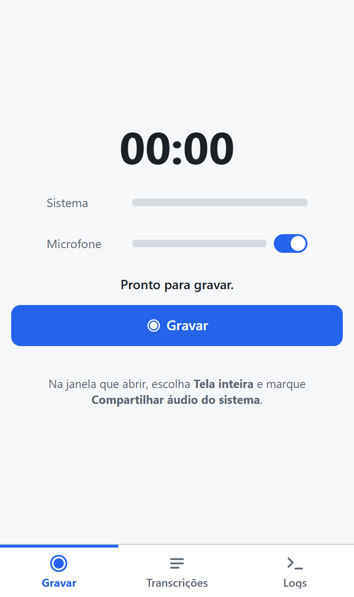
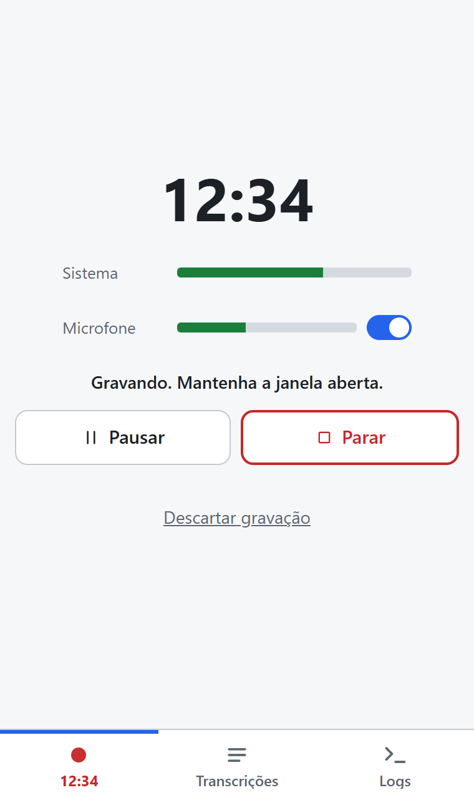
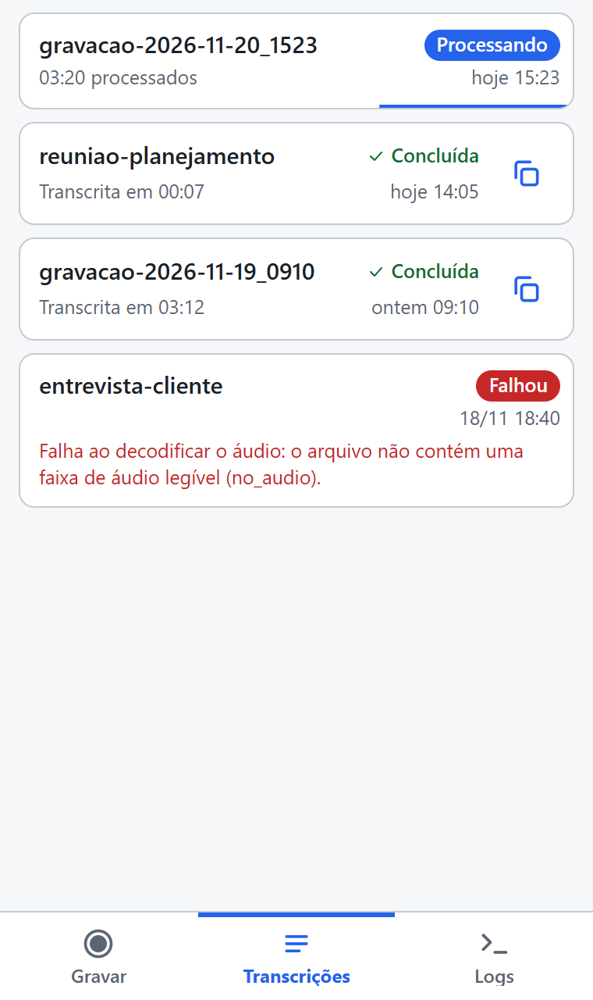
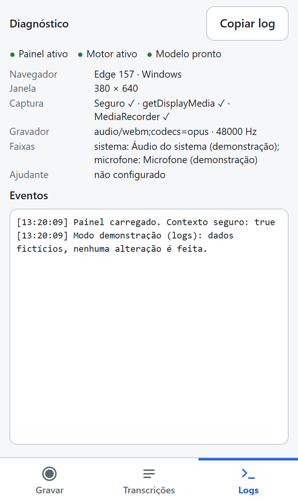

# Whisper Box

Grave uma reunião, deixe o computador transcrever sozinho e abra a pasta com o texto. Tudo roda **localmente**, em Docker: a captura e a transcrição não dependem de API, chave ou custo por uso, e funcionam offline depois da preparação inicial.

| Gravar | Gravando |
| :---: | :---: |
|  |  |
| **Transcrições** | **Logs** |
|  |  |

- [Instalação com IA](#instalação-com-ia-recomendado): cole um prompt no seu agente e ele instala tudo.
- [Para quem usa](#para-quem-usa) — instalar, gravar, transcrever.
- [Para agentes](#para-agentes) — prompt operacional da CLI (é o que o `CLAUDE.md` importa).
- Desenvolvimento: [AGENTS.md](AGENTS.md).

---

# Para quem usa

## O que é

1. **Gravar:** o painel (uma janela pequena do Edge ou do Chrome) grava o áudio do sistema e, se você quiser, o microfone.
2. **Transcrever:** ao clicar em **Transcrever**, a gravação vai para uma fila local. O motor ([faster-whisper](https://github.com/SYSTRAN/faster-whisper), modelo `small`, CPU; o painel detecta o idioma automaticamente) gera o texto sem nenhum agente envolvido.
3. **Abrir a pasta:** na aba **Transcrições**, **Abrir pasta** mostra `saida/<job_id>/` com o texto com horários, a legenda SRT, os segmentos e os metadados.

O mesmo motor também transcreve arquivos de áudio ou vídeo que você já tem (mp4, mp3, m4a, wav…) pela linha de comando, e um agente de código (Claude Code, Codex etc.) pode operá-lo para você: veja [Para agentes](#para-agentes).

## Requisitos

- Windows (validado), Linux ou macOS. A captura do áudio do sistema só funciona em Chrome ou Edge.
- [Python 3.8+](https://www.python.org/downloads/). Não precisa instalar pacotes: o wrapper usa só a biblioteca padrão.
- [Docker](https://docs.docker.com/get-started/get-docker/) com engine Linux (no Windows e no macOS, o Docker Desktop). O FFmpeg já vem dentro da imagem.
- Edge ou Chrome para a janela do painel. Sem eles, o painel abre em qualquer navegador pelo endereço `http://127.0.0.1:8765/`, mas o botão vira **Copiar caminho**.
- Cerca de 500 MB de download (uma única vez), até 2 CPUs (padrão; ajustável com `WHISPER_BOX_CPUS`) e 4 GiB de RAM livres durante a transcrição, e espaço em disco para as gravações e as cópias.

## Instalação com IA (recomendado)

Você não precisa digitar nenhum comando. Abra um agente de código (Claude Code, Codex, Cursor ou similar) em um terminal, na pasta onde quer instalar, e **cole o prompt abaixo**. O agente clona o projeto, confere o ambiente e instala o que faltar, sempre pedindo sua permissão antes de instalar programas ou baixar o modelo. No fim, ele abre o painel.

```text
Instale o Whisper Box neste computador para mim.

1. Clone https://github.com/igorsalgado/whisper-box (ou use o clone que já existir nesta pasta) e trabalhe na raiz dele.
2. Leia o README.md inteiro, principalmente a seção "Para agentes", e siga as regras e a seção "Instalação a pedido do usuário".
3. Antes de instalar qualquer programa (Python, Docker) ou de rodar o prepare (download de cerca de 500 MB), me explique o que vai fazer e peça minha permissão.
4. Rode python whisper-box.py doctor até "ready": true, resolvendo o next_step que ele indicar.
5. No fim, abra o painel com python whisper-box.py painel em segundo plano e me explique como gravar a primeira reunião.

Não grave nem transcreva nada sem eu pedir.
```

- **Tempo:** com Python e Docker já instalados, de 5 a 15 minutos, quase todo no `prepare`. Instalar o Docker Desktop pode exigir administrador, WSL 2 e reiniciar o computador.
- **Se precisar reiniciar:** depois do reinício, abra o agente na mesma pasta e cole o prompt de novo. Ele reaproveita o clone e continua de onde parou.
- **Depois da instalação:** para abrir o painel de novo, rode `python whisper-box.py painel` na pasta do projeto ou peça ao agente "abra o painel do Whisper Box".

## Instalação manual (3 passos)

```bash
git clone https://github.com/igorsalgado/whisper-box.git
cd whisper-box
python whisper-box.py doctor     # 1. diagnostica o ambiente e diz o que falta
python whisper-box.py prepare    # 2. uma vez, com internet: constrói a imagem e baixa o modelo
python whisper-box.py painel     # 3. abre o painel
```

- O `doctor` aponta um `next_step` (instalar ou iniciar o Docker, por exemplo). Resolva e repita até `"ready": true`.
- O `prepare` leva alguns minutos e só é necessário na primeira vez. Depois dele, nada mais usa a internet.
- Use sempre o mesmo clone: o modelo, a fila e os resultados ficam nele.

## Usar o painel

`python whisper-box.py painel` sobe o motor e o painel, abre a janela (380×640, perfil próprio em `.navegador/`) e fica rodando enquanto ela estiver aberta. Feche a janela ou use Ctrl+C para encerrar o ajudante. O motor continua em segundo plano.

1. **Gravar:** clique em **Gravar**. No seletor do navegador, escolha **Tela inteira** e marque **Compartilhar áudio do sistema**. O interruptor ao lado do medidor **Microfone** liga ou desliga a sua voz (antes de começar). É possível pausar e retomar; enquanto grava, a aba **Gravar** mostra o tempo em todas as telas. A gravação é enviada em pedaços de 5 s; mantenha a janela aberta.
2. **Parar e transcrever:** clique em **Parar** e depois em **Transcrever**, ou em **Descartar gravação** (com confirmação). O idioma é detectado automaticamente.
3. **Acompanhar:** na aba **Transcrições**, cada item mostra Na fila, Processando, Concluída ou Falhou. Gravações longas levam vários minutos; como referência, 23 minutos de áudio levaram cerca de 3 minutos em CPU.
4. **Abrir a pasta:** em uma transcrição concluída, **Abrir pasta** abre `saida/<job_id>/` no gerenciador de arquivos. Se o painel estiver aberto fora da janela criada pelo comando, o botão vira **Copiar caminho**.
5. **Logs:** a aba mostra o diagnóstico (motor, modelo, navegador) e os eventos da sessão, com botão para copiar. Nenhum deles contém áudio ou texto da reunião.

Atalhos: **Espaço** grava, pausa ou retoma (na aba Gravar); **Alt+1/2/3** alternam entre Gravar, Transcrições e Logs; **Esc** fecha a confirmação de descarte. Os prints acima foram gerados com o modo demonstração (`http://127.0.0.1:8765/?demo=gravar|gravando|pausado|parado|transcricoes|logs`), que usa dados fictícios e não grava nem envia nada.

Para parar tudo, use `python whisper-box.py stop`.

> **Consentimento:** gravar uma reunião exige a ciência dos participantes. A responsabilidade é de quem grava.

## Onde ficam os arquivos

| Local | Conteúdo |
| --- | --- |
| `saida/<job_id>/` | `transcricao.txt` (texto com horários), `transcricao.srt`, `segmentos.jsonl`, `metadados.json` e `manifest.json` (hashes de integridade). |
| `saida/.partial/` | Tentativas incompletas; nunca são anunciadas como resultado. |
| `entrada/<job_id>/` | Cópia da mídia enviada à fila. **Apagada automaticamente após a transcrição concluída e verificada** (padrão `delete`); veja “Limpeza e retenção”. |
| `entrada/.gravacoes/` | Gravações do painel ainda não enviadas (arquivos `.part`). Cancelar ou transcrever as remove daqui; o que ficar abandonado por mais de 7 dias é removido pelo painel. |
| `analises/<job_id>/analise.md` | Análise (resumo, decisões, tarefas) feita por um agente a partir do texto; fora de `saida/` e do Git. |
| `modelos/` | Modelo, revisão e hashes. |
| `.navegador/` | Perfil da janela do painel. |
| Volume Docker `whisper-box_state` | Fila SQLite, trava do worker e sinal de saúde. |

### Limpeza e retenção

- **Cópia de entrada (padrão: apagar):** depois que a transcrição termina e o resultado é verificado (`manifest.json` com hashes), o worker apaga `entrada/<job_id>/` e mantém `saida/<job_id>/`. **Para gravações feitas no painel, essa cópia era o único exemplar do áudio: depois da transcrição ele deixa de existir.** Para arquivos enviados pela linha de comando, o original continua intacto onde estava. Transcrições com falha mantêm a entrada. Reenviar a mesma mídia continua devolvendo o trabalho existente (`reused: true`).
- **Configurar:** `WHISPER_BOX_INPUT_RETENTION` (lida pelo worker): `delete` (padrão), `keep` (nunca apaga) ou `<N>d` (por exemplo `7d`: apaga as cópias de trabalhos concluídos há mais de N dias, verificadas, a cada hora). Defina antes de `python whisper-box.py start`; valor inválido equivale a `keep`. A retenção só vale para trabalhos concluídos depois que ela foi ativada neste clone; o histórico anterior é limpo só por `purge`.
- **Resíduos técnicos (automático):** `saida/.partial/` é esvaziado ao iniciar o worker e após falha; gravações abandonadas em `entrada/.gravacoes/` somem após `WHISPER_BOX_STAGING_DAYS` dias (padrão 7).
- **Remoção explícita:** `python whisper-box.py purge --job ID` (ou `--older-than DIAS [--status failed|succeeded]`) **só lista** o que seria removido; para apagar de fato acrescente `--yes`. Remove a entrada, a saída, os parciais e o registro do trabalho. `--inputs-only` remove apenas a cópia de entrada e mantém a transcrição. Trabalhos na fila ou em processamento são recusados (`job_active`).
- **Espaço em disco:** a aba **Logs** mostra o espaço livre; a aba **Gravar** avisa quando há menos de `WHISPER_BOX_DISK_WARN_GIB` GiB livres (padrão 5), sem impedir a gravação.
- `saida/` nunca é apagada automaticamente.

Em Linux, arquivos criados pelo container pertencem ao `root`: são legíveis, mas a remoção pode exigir `sudo`. Gravações, transcrições, modelos, logs e estado ficam fora do Git.

## Privacidade e segurança

- Captura e transcrição são **100% locais**: o áudio nunca sai da máquina e nenhuma API de transcrição em nuvem é usada.
- O worker roda sem rede (`network_mode: none`). Apenas o `prepare` usa internet.
- O painel é o único serviço com rede e só escuta em `127.0.0.1` (porta 8765, ou `WHISPER_BOX_PAINEL_PORT`). Valida `Host` e `Origin` e roda sem capabilities e com sistema de arquivos somente leitura.
- A análise do texto por um agente (ata, resumo, decisões) é permitida. Essa é uma decisão deste projeto pessoal. Só o texto pedido é lido, e o áudio nunca é enviado.

## Limitações

- Sem identificação de falantes e sem resumo ou ata automáticos no motor. A análise é feita por um agente, sob pedido, pela skill `whisper-box-analise` (ou pela receita do [AGENTS.md](AGENTS.md)): “resuma a reunião de ontem” gera `analises/<job_id>/analise.md`. A qualidade depende da transcrição automática.
- A captura exige Chrome ou Edge; Firefox e Safari não capturam o áudio do sistema. No macOS, o áudio do sistema no navegador é limitado.
- Uma gravação do painel tem no máximo 2 GiB. Fechar a janela no meio de uma gravação perde o que ainda não foi enviado (poucos segundos); o que já chegou fica em `entrada/.gravacoes/`.
- A transcrição é automática: nomes próprios, siglas, ruído e falas simultâneas podem exigir revisão. Fronteiras de cinco minutos podem dividir palavras. Silêncio gera texto vazio com `no_speech: true`; mídia sem áudio falha.
- O motor processa um trabalho por vez, em CPU, com `small`/`int8`. A fila é FIFO: uma gravação curta espera as longas que vieram antes (o log `job_started` traz `queue_wait_seconds`). Se o worker cair no meio, o arquivo recomeça do zero, com até três tentativas automáticas (sem retomada por bloco).
- Validado em Windows com Docker Linux amd64. A captura real de áudio do sistema e do microfone no painel foi validada pelo usuário em 20/11/2026 (“todas as funcionalidades estão ok”; registro em [VALIDACAO.md](docs/VALIDACAO.md)); Linux, macOS e ARM não foram ensaiados.

## Mais detalhes

[docs/VALIDACAO.md](docs/VALIDACAO.md) (medições) · [docs/painel-api.md](docs/painel-api.md) (API do painel) · [A01](docs/actions/A01-transcricao-offline-docker.md) (motor e CLI) · [A02](docs/actions/A02-captura-ingestao-analise.md) (captura, painel e análise). Motor: [faster-whisper](https://github.com/SYSTRAN/faster-whisper), [CTranslate2](https://github.com/OpenNMT/CTranslate2), [PyAV](https://pyav.org/docs/stable/) e [Systran/faster-whisper-small](https://huggingface.co/Systran/faster-whisper-small), cada um com sua licença. O projeto ainda não define licença própria.

---

# Para agentes

> **Esta seção é um prompt.** Se você é um agente de código (Claude Code, Codex, Cursor ou similar), os textos abaixo são as suas instruções para operar este projeto pela CLI. Siga-os do início ao fim. Para alterar o projeto, siga o [AGENTS.md](AGENTS.md).
>
> Humano: para instalar, cole no seu agente o prompt de [Instalação com IA](#instalação-com-ia-recomendado). Para transcrever um arquivo que você já tem, diga **“Clone https://github.com/igorsalgado/whisper-box, leia o README e transcreva uma gravação minha.”**

## Sua missão

Transcrever gravações de áudio ou vídeo do usuário **localmente**, com Docker, e devolver os caminhos dos arquivos gerados: TXT com horários, legenda SRT, segmentos JSONL e metadados JSON.

O projeto já contém o motor (faster-whisper `small`, CPU, `int8`, português por padrão na CLI), a fila, a deduplicação e a recuperação de falhas. Tudo isso roda dentro da imagem Docker, inclusive o FFmpeg, que vem embutido como biblioteca no PyAV e decodifica mp4, mp3, m4a, wav e outros formatos. O host não precisa de FFmpeg nem de bibliotecas Python. Seu trabalho é **preparar o ambiente, pedir o arquivo, executar um comando e reportar o resultado**. Depois da preparação inicial, a transcrição roda offline, sem API, chave ou custo de tokens.

## Regras invioláveis

1. Use somente `whisper-box.py`. Não escreva código de transcrição, não instale faster-whisper/FFmpeg no host e não crie scripts `.ps1`/`.sh`.
2. Peça permissão ao usuário antes de instalar software no sistema (Python, Docker) e antes do download inicial (`prepare`).
3. **Captura e transcrição são locais:** nunca envie a gravação (áudio ou vídeo) para fora da máquina nem use APIs de transcrição em nuvem. A **análise do texto** (resumo, ata, decisões, tarefas) por você, o agente do usuário, é permitida: é uma decisão deste projeto pessoal. Leia a transcrição somente quando o usuário pedir essa análise e use apenas o conteúdo necessário.
4. Não mova, renomeie ou apague o arquivo original do usuário.
5. Não rode `docker compose down -v` e não apague `entrada/`, `saida/`, `modelos/` ou volumes para “corrigir” falhas. A limpeza de disco é feita só por `purge` (regra 10) e pela retenção automática.
6. Não rode `prepare` a cada reunião; ele é feito uma única vez.
7. Leia stdout como JSON e stderr como diagnóstico, em canais separados. Nunca use `2>&1` ao interpretar a resposta.
8. Não cole a transcrição na conversa, a menos que o usuário peça resumo, ata ou análise.
9. Não suba o painel (`painel`) por conta própria: ele é a interface do humano e bloqueia até a janela fechar. Rode-o somente se o usuário pedir (o prompt de instalação pede), em segundo plano.
10. **`purge --yes` só a pedido explícito do usuário.** Apaga entrada, saída e registro de forma irreversível. Em qualquer outro caso use apenas `purge` sem `--yes` (dry-run, que não altera nada) e mostre o resultado. Nunca use `purge` para “corrigir” falhas.

## Instalação a pedido do usuário

Quando o usuário pedir para **instalar** (por exemplo, colando o prompt de “Instalação com IA”), o objetivo é deixar o ambiente pronto e o painel aberto, sem transcrever nada:

1. Execute os passos 0, 1 e 2 abaixo, nessa ordem, até o `doctor` devolver `"ready": true` com `next_step.code` igual a `ask_for_recording`. Peça permissão antes de cada instalação de software e antes do `prepare` (regra 2), e explique em uma frase o que cada um faz.
2. Se uma instalação exigir reinício ou administrador e você não puder concluir, entregue ao usuário o comando exato e diga para, depois, abrir o agente na mesma pasta e colar o prompt de novo. Não crie outro clone: os passos são idempotentes e continuam de onde pararam.
3. Com o ambiente pronto, abra o painel **em segundo plano**, porque o comando bloqueia até a janela fechar: `python whisper-box.py painel`. Esse é o pedido explícito previsto na regra 9. Confirme em stdout `{"status": "open", "painel_url": ...}`. Se vier `browser_not_found`, informe a URL `http://127.0.0.1:8765/` e explique que, fora da janela própria, o botão **Abrir pasta** vira **Copiar caminho**.
4. Não pule para o passo 3 (pedir gravação), a menos que o usuário peça uma transcrição.
5. Responda com:
   - o que foi instalado e a pasta do projeto (`project_root` do `doctor`);
   - como gravar: clicar em **Gravar**, escolher **Tela inteira**, marcar **Compartilhar áudio do sistema** e, ao terminar, clicar em **Parar** e depois em **Transcrever**;
   - onde ficam as transcrições: aba **Transcrições** e **Abrir pasta** (`saida/<job_id>/`);
   - como reabrir o painel depois: `python whisper-box.py painel` na pasta do projeto;
   - um lembrete de que gravar uma reunião exige a ciência dos participantes.

## Passo 0 — Obter o projeto

Se o repositório ainda não estiver na máquina, clone-o e trabalhe na raiz:

```bash
git clone https://github.com/igorsalgado/whisper-box.git
cd whisper-box
```

Reutilize sempre o mesmo clone. O modelo, a fila e os resultados ficam nele; um clone novo exige preparar tudo de novo.

## Passo 1 — Garantir Python 3.8+

Teste, nesta ordem, até um responder 3.8 ou superior: `python --version`, `python3 --version` e, no Windows, `py -3 --version`. Nos exemplos abaixo, `python` significa o interpretador encontrado.

Se nenhum existir, peça permissão e instale:

| Sistema | Comando |
| --- | --- |
| Windows | `winget install -e --id Python.Python.3.12` |
| macOS | `brew install python` |
| Linux | `sudo apt install python3` / `sudo dnf install python3` (conforme a distribuição) |

Nenhum `pip install` é necessário: o wrapper usa só a biblioteca padrão.

## Passo 2 — Diagnosticar e corrigir o ambiente

```bash
python whisper-box.py doctor
```

A resposta é um JSON com `ready`, `platform`, `project_root`, `checks` e **um** `next_step`. Execute o passo indicado e rode `doctor` de novo, até `"ready": true`.

| `next_step.code` | O que você faz |
| --- | --- |
| `install_docker` / `install_compose` | Explique ao usuário e peça permissão (`requires_user_approval: true`). Instale com o comando de `next_step.action`. Pode exigir administrador, WSL 2 ou reinício; se você não puder executar, entregue a instrução ao usuário e aguarde. |
| `start_docker` | Inicie o Docker conforme `action`, aguarde até cerca de 2 minutos e rode `doctor` novamente. |
| `rebuild` | A imagem Docker está defasada em relação ao código local (`requires_user_approval: false`). Execute o comando de `next_step.action` (`python whisper-box.py stop` e depois `docker compose build ... worker`) e rode `doctor` de novo. |
| `prepare` | Avise que será baixado ~500 MB uma única vez, com internet. Com o ok, execute `python whisper-box.py prepare` (pode levar vários minutos). |
| `ask_for_recording` | Ambiente pronto. Vá ao passo 3. |

Recursos: o worker usa por padrão até **2 CPUs e 4 GiB de RAM**, sem GPU. O número de CPUs é configurável (`WHISPER_BOX_CPUS`, abaixo); a memória não. Garanta espaço para a imagem, o modelo e as cópias das gravações.

## Passo 3 — Pedir a gravação ao usuário

Se o caminho ainda não estiver na conversa, pergunte:

> Qual gravação devo transcrever? Envie o caminho completo do arquivo — por exemplo `C:\Reunioes\call.mp4` ou `/home/voce/Reunioes/call.mp4`. Aceito vídeo ou áudio (mp4, mp3, wav, m4a…). A gravação precisa estar finalizada. Vou transcrever em português, a menos que você prefira inglês, espanhol ou detecção automática.

- O arquivo precisa estar **no computador que roda o Docker**. Se o usuário anexou o arquivo na conversa e ele já existe localmente, use esse caminho; caso contrário, peça o caminho local.
- Caminhos com espaços e acentos são aceitos. Caminhos POSIX com `:` e caminhos de rede (`\\servidor\pasta`, não testados) são recusados com `unsupported_path` (código 3): peça ao usuário para copiar o arquivo para um disco local, em um caminho sem `:`.
- Uma gravação por chamada. Para várias, transcreva em sequência.

## Passo 4 — Transcrever

```bash
python whisper-box.py transcribe --input "CAMINHO" --language pt
```

- `--language`: `pt` (padrão da CLI), `en`, `es` ou `auto`. (O painel usa `auto`.)
- O comando sobe o worker (`start`, sem o painel), copia e enfileira a gravação, aguarda e verifica o resultado. Ele **bloqueia até terminar**, com orçamento de 2 horas (`--timeout-seconds`, de 1 a 86400).
- stderr recebe `{"event": "whisper_waiting", "job_id": "..."}`. **Guarde o `job_id`.**
- Se a sua ferramenta de execução tiver limite de tempo, rode o comando em segundo plano ou com tempo maior. Se a execução cair ou o orçamento acabar, retome com:

```bash
python whisper-box.py transcribe --job JOB_ID
```

- **Nunca** submeta a mesma gravação de novo só porque a espera terminou: a fila continua processando. Mesmo que submeta, os mesmos bytes com o mesmo idioma reutilizam o trabalho existente (`reused: true`). A exceção é o trabalho `succeeded` cuja pasta `saida/<job_id>/` foi perdida: reenviar a mesma gravação o reprocessa (novo `job_id`, `reused: false`; o antigo fica `failed` com `output_lost`).
- Falhas transitórias do Docker durante a espera são repetidas até 2 vezes (2 s e 5 s) pelo próprio comando. Todo erro depois do envio traz o `job_id` em stdout; Ctrl+C devolve `interrupted` e estouro de tempo de um subprocesso devolve `docker_timeout`, ambos com código 1 e o container de CLI removido.
- Referência medida: 23 minutos de áudio levaram cerca de 3 minutos em CPU. Informe ao usuário que gravações longas podem levar vários minutos.

## Passo 5 — Interpretar e responder

| Código de saída | Significado | O que você faz |
| --- | --- | --- |
| `0` | Concluído e verificado. | Entregue os caminhos de `files`. |
| `1` | Falha da transcrição ou do ambiente. | Relate `error.code` e `error.message`; consulte a tabela de erros. |
| `2` | Orçamento de espera esgotado; o trabalho continua. | Informe o `job_id` e retome com `transcribe --job`. |
| `3` | Argumento, arquivo ou trabalho inválido. | Corrija ou peça outro caminho ao usuário. |
| `4` | `result` de trabalho ainda pendente (não ocorre em `transcribe`). | Use `wait` e repita `result`. |

Resposta de sucesso (Windows; em Linux/macOS os caminhos são `/home/.../saida/...`):

```json
{
  "job_id": "identificador",
  "status": "succeeded",
  "files": {
    "text": "C:\\Projetos\\whisper-box\\saida\\identificador\\transcricao.txt",
    "srt": "C:\\Projetos\\whisper-box\\saida\\identificador\\transcricao.srt",
    "segments": "C:\\Projetos\\whisper-box\\saida\\identificador\\segmentos.jsonl",
    "metadata": "C:\\Projetos\\whisper-box\\saida\\identificador\\metadados.json"
  },
  "output_relative": "saida/identificador"
}
```

Responda ao usuário assim:

> Transcrição concluída (job `JOB_ID`).
> - Texto com horários: `files.text`
> - Legendas SRT: `files.srt`
> - Segmentos e metadados: `files.segments`, `files.metadata`

Se o usuário pediu resumo, ata, decisões ou tarefas, siga o passo seguinte. Avise sempre que a transcrição é automática: nomes próprios, siglas, ruído e falas simultâneas podem exigir revisão.

## Passo 6 — Analisar uma transcrição (sob pedido)

Só quando o usuário pedir resumo, ata, decisões ou tarefas. No Claude Code use a skill `whisper-box-analise` (`.claude/skills/`); nos demais agentes siga a receita “Analisar transcrições” do [AGENTS.md](AGENTS.md). Em resumo: localize a reunião com `list --status succeeded --since AAAA-MM-DD --until AAAA-MM-DD` (pergunte se houver mais de uma candidata; trabalhos da CLI têm `source_name` `recording.<ext>`, então use data/hora e duração), leia apenas `files.text` desse job, cite horários `[hh:mm:ss]` de segmentos reais e grave em `analises/<job_id>/analise.md`, **nunca** em `saida/`. Confira com `python tests/check_analise.py` e com `result --job ID` (código 0).

## Erros e como agir

| Sinal | O que você faz |
| --- | --- |
| `python` não encontrado | Passo 1. No Windows, tente `py -3 whisper-box.py`. |
| `docker_error`, `worker_unavailable` | Rode `doctor`, corrija e repita `transcribe` (com `--job` se já houver identificador). |
| `permission denied` no socket do Docker (Linux) | Peça permissão para `sudo usermod -aG docker $USER`; o usuário precisa abrir nova sessão. |
| `model_not_ready` | Rode `doctor` e, se indicado, `prepare`. Se o modelo estiver corrompido, peça ao usuário para preservar/renomear `modelos/` antes de preparar de novo. |
| `input_not_found` | Confirme o caminho com o usuário. |
| `input_changed` | A gravação ainda está sendo escrita; aguarde terminar e repita. |
| `invalid_media`, `no_audio` | O arquivo não tem áudio legível; peça outro. |
| `browser_not_found` (`painel`) | Edge ou Chrome ausente: informe a URL da mensagem ou defina `WHISPER_BOX_NAVEGADOR` com o caminho do executável. |
| `failed` com outro motivo | Relate o erro; uma nova submissão cria outro `job_id` e preserva o histórico. |
| `output_incomplete` | A pasta `saida/<job_id>/` sumiu ou foi alterada. Não apague nada; reenvie a mesma gravação para reprocessar (o job antigo passa a `output_lost`). |
| `output_lost` | Job antigo cuja saída foi perdida e que já foi reprocessado em outro `job_id`. Use o `job_id` novo de `submit`/`list`. |
| `output_unreachable` | Os arquivos existem no motor, mas o host não os alcança. Não apague nada; relate ao usuário com o `job_id`. |
| `unsupported_path` | Caminho com `:` (POSIX) ou de rede (UNC): peça uma cópia em disco local, em um caminho sem `:`. |
| `docker_timeout`, `interrupted` | O Docker não respondeu a tempo ou houve Ctrl+C. Com `job_id`, retome com `transcribe --job`; sem ele, rode `doctor` e repita. |
| `operational_error` | Falha inesperada do wrapper (o tipo da exceção vai para stderr). Rode `doctor` e repita. |
| Worker encerrado por memória | Relate; peça ao usuário para reduzir outras cargas. Não altere limites por conta própria. |

## Referência

### Comandos

Todos são `python whisper-box.py COMANDO` e escrevem um único JSON em stdout (exceto `logs`). Comando desconhecido ou sem argumentos devolve `invalid_arguments` com código 3.

| Comando | Uso |
| --- | --- |
| `doctor` | Diagnostica Python, Docker, Compose, engine, imagem e modelo; indica um `next_step`. Código 0 quando pronto, 1 caso contrário. |
| `transcribe --input CAMINHO` | Fluxo completo: start do worker, submit, espera renovada e resultado verificado. Aceita `--language` (`pt`, `en`, `es`, `auto`; padrão `pt`) e `--timeout-seconds`. |
| `transcribe --job ID` | Retoma um trabalho existente, sem submeter de novo (não aceita `--language`). |
| `purge --job ID [--yes]` / `purge --older-than DIAS [--status S] [--yes]` | Remove trabalhos (entrada, saída, parciais e registro). **Sem `--yes`, apenas lista** `{"dry_run": true, "would_purge": [...], "freed_bytes": N}`; com `--yes` apaga e devolve `{"dry_run": false, "purged": [...], "freed_bytes": N}`. `--inputs-only` limita a remoção à cópia de entrada. Recusa `queued`/`running` (`job_active`, 3), `job_id` malformado e job inexistente (`job_not_found`, 3); falha parcial devolve `errors` e código 1. |
| `prepare` | Uma vez, com internet: constrói a imagem (saída do build em stderr) e baixa/verifica o modelo. Preserva a revisão já instalada. Um único JSON em stdout, inclusive em falha. |
| `start` | Sobe worker **e painel**. Devolve `{"status":"ready","painel_url":"http://127.0.0.1:8765/"}`. Se só o painel falhar, devolve `painel_error` no lugar de `painel_url`; o código de saída segue o do worker. |
| `stop` | Para worker e painel; fila, modelo e arquivos são preservados. Devolve `{"status":"stopped"}`. |
| `painel` | Para o humano: garante worker e painel no ar, abre Edge/Chrome em modo app (perfil `.navegador/`, janela 380×640) e mantém um ajudante em `127.0.0.1:8766` (próximas portas se ocupada; `WHISPER_BOX_AJUDANTE_PORT`), com token por execução, que abre `saida/<job_id>` no gerenciador de arquivos. Imprime `{"status":"open","painel_url":"...","ajudante_port":8766}` e **bloqueia** até a janela fechar ou Ctrl+C. Procura o navegador em locais padrão ou em `WHISPER_BOX_NAVEGADOR`; sem ele devolve `browser_not_found` (código 1) com a URL na mensagem. |
| `submit --input CAMINHO [--language pt]` | Só enfileira e devolve `job_id`. Não sobe o worker; rode `start` antes. |
| `wait --job ID --timeout 30` | Aguarda de 1 a 60 segundos; código 2 se o tempo acabar. |
| `list [--status S] [--since AAAA-MM-DD] [--until AAAA-MM-DD] [--limit N]` | Localiza transcrições, do mais recente ao mais antigo (`{"jobs": [...]}`, lista vazia é sucesso). `--limit` de 1 a 200 (padrão 20); `--since`/`--until` inclusivos no fuso do host; `--status` em `queued`, `running`, `succeeded`, `failed`. Cada item traz `job_id`, `source_name`, `status`, `language`, `created_at`/`started_at`/`finished_at` (ISO 8601 com fuso), `duration_seconds`, `progress_seconds` e, só em `succeeded` com saída verificada, `files` e `output_relative`; `error` só em `failed`. Nunca inclui texto da reunião. Valores inválidos: código 3. |
| `status --job ID` / `result --job ID` | Estado e progresso / caminhos verificados; `result` devolve código 4 se o trabalho ainda estiver pendente. |
| `logs` | Últimos 50 eventos do worker, para diagnóstico. |

`wait`, `status`, `result` e `list` usam `docker compose exec` no worker em execução (cerca de 0,4 s por consulta) e caem para `run --rm cli` quando o worker está parado; o contrato (um JSON, códigos 0 a 4) é o mesmo. O log do worker (`python whisper-box.py logs`) registra, por job, `job_started` (com `queue_wait_seconds`) e `job_succeeded` (com `rtf`, `duration_seconds`, `processing_seconds`, `attempts` e `peak_memory_bytes`, o pico do container desde que subiu), além de `job_stalled` quando um job fica sem progresso além de `WHISPER_BOX_STALL_SECONDS`. `metadados.json` traz `runtime` (threads e CPUs).

Estados: `queued`, `running`, `succeeded`, `failed`. `progress_seconds` é a posição processada no áudio, não uma previsão de término. O campo `error` só aparece em `failed`; um trabalho recolocado na fila após interrupção do worker não o traz.

Variáveis de ambiente: `WHISPER_BOX_CPUS` (CPUs do worker, padrão 2; define também as threads de inferência, que **entram na deduplicação**: 2, 3 e 4 threads produzem textos diferentes, então mudar o valor reprocessa uma mídia já transcrita; lida ao subir o worker, então rode `stop` e `start` depois de mudar; use o mesmo valor em todos os comandos, de preferência num `.env` ao lado do `compose.yaml`; o `doctor` informa o valor quando não é 2), `WHISPER_BOX_CPU_THREADS` (threads, padrão igual a `WHISPER_BOX_CPUS`; separar os dois é para benchmark), `WHISPER_BOX_STALL_SECONDS` (job `running` sem progresso por mais de N s torna o healthcheck do worker vermelho e registra `job_stalled`; padrão 1200; não reinicia nada), `WHISPER_BOX_INPUT_RETENTION` (`delete` padrão, `keep` ou `<N>d`; lida pelo worker ao iniciar), `WHISPER_BOX_STAGING_DAYS` (gravações abandonadas do painel, padrão 7), `WHISPER_BOX_DISK_WARN_GIB` (aviso de pouco espaço, padrão 5), `WHISPER_BOX_PAINEL_PORT` (porta do painel, padrão 8765), `WHISPER_BOX_AJUDANTE_PORT` (padrão 8766), `WHISPER_BOX_NAVEGADOR` (executável do navegador).

### Garantias do sistema

- Fechar o terminal, desconectar o agente ou esgotar a espera **não** interrompe o worker; retome pelo mesmo `job_id`.
- Após uma interrupção, o worker recupera o trabalho e pode reiniciar o arquivo, com até três tentativas automáticas.
- Resultados só aparecem completos e com hashes verificados; alterar arquivos finais invalida a verificação.
- Worker e containers de trabalho rodam com `network_mode: none`; apenas `prepare` usa internet. Sem telemetria, credenciais ou envio de mídia. Logs não contêm o texto da reunião.
- O painel é a única exceção de rede: bridge própria, publicado somente em `127.0.0.1`, sem capabilities, com `saida/` e `modelos/` somente leitura. Contrato em [docs/painel-api.md](docs/painel-api.md).

### Limitações para informar ao usuário

- Sem captura ao vivo pela CLI (a captura é do painel), sem identificação de falantes e sem resumo automático.
- Silêncio gera texto vazio com `no_speech: true`; mídia sem áudio falha.
- Fronteiras de cinco minutos podem dividir palavras.
- Validado em Windows com Docker Linux amd64. Linux e macOS são suportados, mas ainda sem ensaio completo registrado; ARM não foi testado.

## Se pedirem para alterar o projeto

Operar e desenvolver são tarefas diferentes. Para mudar código, testes ou documentação, siga [AGENTS.md](AGENTS.md) (regras por componente, testes em Docker e Git). Evidências medidas: [docs/VALIDACAO.md](docs/VALIDACAO.md). Contratos: [A01](docs/actions/A01-transcricao-offline-docker.md) (motor e CLI) e [A02](docs/actions/A02-captura-ingestao-analise.md) (captura, painel e análise).
